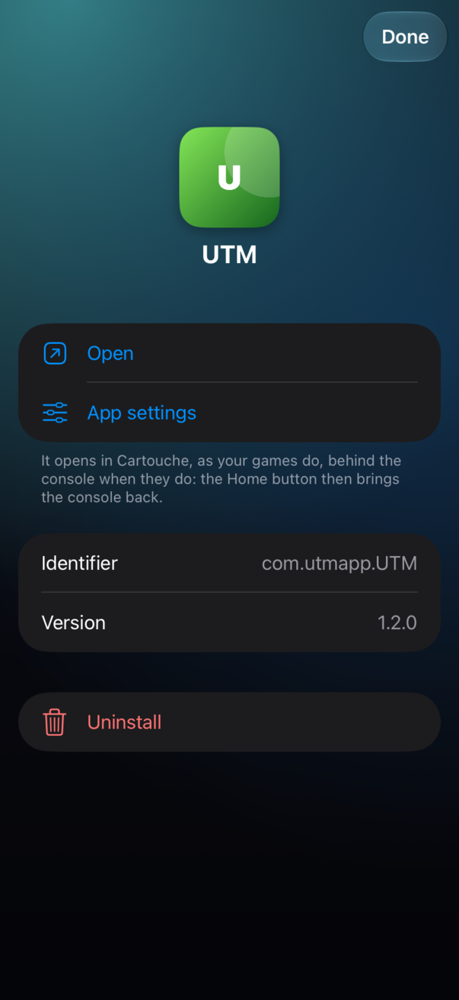
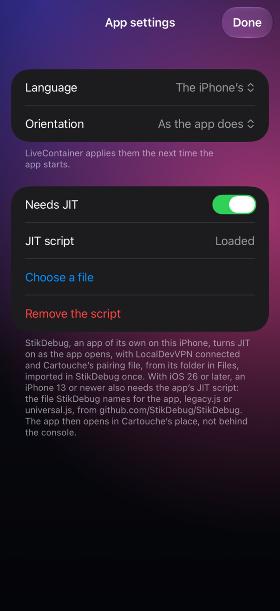
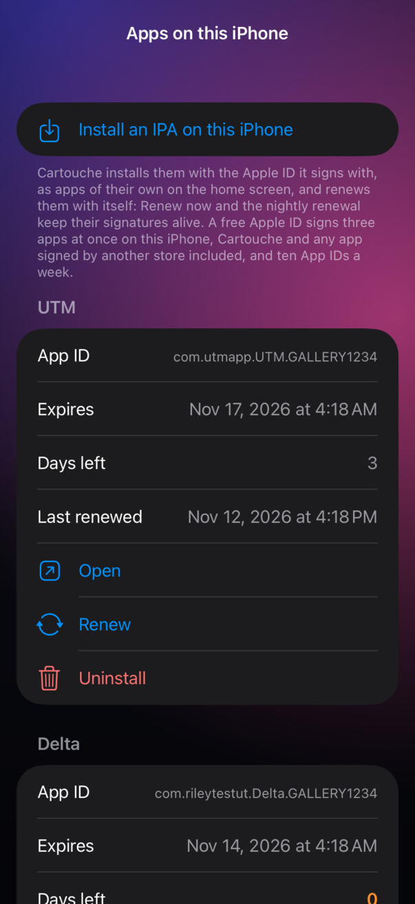
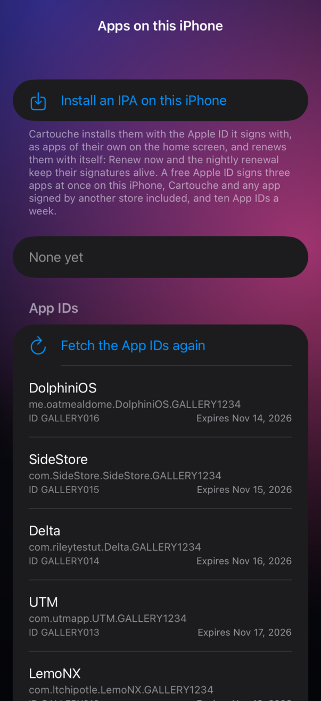

## This fork: branch `dev`

This is [Hackiri's fork](https://github.com/Hackiri/Cartouche) of [cartouche-app/Cartouche](https://github.com/cartouche-app/Cartouche). Its [`main`](https://github.com/Hackiri/Cartouche/tree/main) mirrors upstream; everything added here lives on [`dev`](https://github.com/Hackiri/Cartouche/tree/dev) ([what it changes](https://github.com/Hackiri/Cartouche/compare/main...dev)), decisions [139](docs/decisions/139.md) to [142](docs/decisions/142.md) and [144](docs/decisions/144.md):

- **Apps that are not games, on screens of Cartouche's own.** An IPA that is not a game sits on the shelf after the games, as an icon cartridge, with **Open** and **Details**; its sheet and its settings page are Cartouche's: the language, the orientation, **Needs JIT** with the app's script for StikDebug, **Uninstall**. No page of LiveContainer's or SideStore's opens.
- **Apps on this iPhone.** From the System page, Cartouche installs an IPA as an app of its own on the home screen through its built-in SideStore, lists the apps it installed with their App ID and when their signature expires, renews them with itself, nightly too, and uninstalls them. Under them, **App IDs** lists the App IDs Apple keeps for the Apple ID, as SideStore's App IDs page does, fetched on demand: which ones hold the ten a free Apple ID registers in seven days.
- **Cartouche Cloud asks before it links.** A `cartouche://cloud/link?code=…` link, from the site's **Open in Cartouche** button, a QR code or anywhere else, only fills in the code: Cartouche asks before it links this iPhone to that account, and says when it would take the place of the account linked already.

&nbsp;&nbsp;&nbsp;&nbsp;

For everything else, what Cartouche is, how to install it, build it and contribute, read the [README on `main`](https://github.com/Hackiri/Cartouche/tree/main#readme), which is upstream's.
